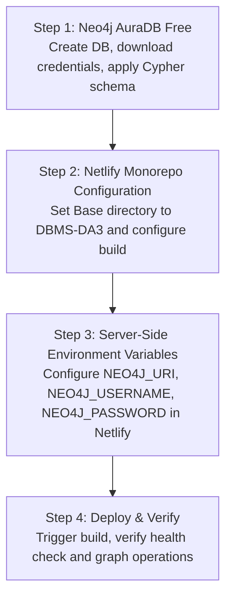

# SwiftShip DBMS-DA3 Deployment Guide: 100% Netlify Free + Neo4j AuraDB Free

This guide provides end-to-end instructions for deploying the **SwiftShip Courier Management System (DBMS-DA3)** completely on **Netlify Free**, using **Netlify Functions (Node.js)** for the full REST API backend and **Neo4j AuraDB Free** for cloud graph persistence.

> [!IMPORTANT]
> - **100% Free Tier**: No paid hosting, no external servers (no Koyeb, no Render, no Railway, no AWS EC2) required.
> - **Same-Origin Serverless API**: Frontend and backend are hosted under the same Netlify domain (`https://<your-site>.netlify.app`), eliminating CORS problems and cross-origin latency.
> - **DA2 Preservation**: All DA2 Oracle database code, SQL schemas, EC2 deployment scripts, and systemd services remain strictly untouched in the repository root. All DA3 changes are confined to `DBMS-DA3/`.
> - **Reference Java Backend**: The Java 21 / Spring Boot 3.3.5 backend remains preserved inside `DBMS-DA3/backend/` with all 30 unit tests passing.

---

## 1. System Architecture

```mermaid
flowchart LR
    Browser["Client Browser<br/>(SPA UI)"]
    NetlifySite["Netlify CDN<br/><code>DBMS-DA3/frontend/</code><br/>HTML5, CSS3, Vanilla JS"]
    NetlifyFunc["Netlify Functions<br/><code>DBMS-DA3/netlify/functions/api.mjs</code><br/>Node.js 20+ ES Modules"]
    AuraDB["Neo4j AuraDB Free<br/><code>neo4j+s://...databases.neo4j.io</code><br/>Cloud Graph Database"]

    Browser -->|HTTPS Same-Origin| NetlifySite
    Browser -->|/api/* & /actuator/health| NetlifyFunc
    NetlifyFunc -->|Bolt+TLS (neo4j+s)| AuraDB
```

- **Frontend**: Static single-page application located at `DBMS-DA3/frontend/`.
- **Backend API**: Netlify Serverless Functions located at `DBMS-DA3/netlify/functions/`.
- **Database**: Cloud-hosted **Neo4j AuraDB Free** instance.

---

## 2. Order of Deployment



---

### Step 1 — Neo4j AuraDB Free Setup

1. Sign up or log in to the [Neo4j Aura Console](https://console.neo4j.io/).
2. Create an instance (or reuse your existing instance):
   - Click **New Instance** → Choose **AuraDB Free**.
   - Name: `SwiftShip-Courier` (or any preferred name).
   - **Download the credentials file** containing:
     - **URI**: `neo4j+s://<dbid>.databases.neo4j.io`
     - **Username**: `neo4j`
     - **Password**: `<your-auradb-password>`
3. Once the database status shows **Running**, click **Query** (Neo4j Browser).
4. Run the schema initialization script from:
   ```cypher
   // Open DBMS-DA3/backend/schema/neo4j_schema.cypher and execute all Cypher statements
   ```
   This safely creates all uniqueness constraints and indexes without deleting data.

---

### Step 2 — Netlify Site Configuration

1. Log in to [Netlify](https://app.netlify.com/).
2. Open your existing site (e.g. `https://app.netlify.com/sites/dbmsda3`) or click **Add new site** → **Import an existing project** → **GitHub** → choose `NithinSarvesh/CourierManagement`.
3. In **Site configuration** → **Build & deploy** → **Continuous deployment**:
   Configure these exact monorepo parameters:

| Setting | Value | Explanation |
| :--- | :--- | :--- |
| **Branch to deploy** | `main` | Production branch |
| **Base directory** | `DBMS-DA3` | Netlify operates inside `DBMS-DA3` where `package.json` and `netlify.toml` live |
| **Package directory** | *(Leave empty)* | Not needed when Base directory is set to `DBMS-DA3` |
| **Build command** | `npm install` | Installs `neo4j-driver` for serverless functions |
| **Publish directory** | `frontend` | Publishes static UI assets from `DBMS-DA3/frontend` |
| **Functions directory** | `netlify/functions` | Bundles Node.js serverless functions from `DBMS-DA3/netlify/functions` |

> [!NOTE]
> `DBMS-DA3/netlify.toml` automatically configures `publish = "frontend"`, `functions = "netlify/functions"`, and routing rules (`/api/*` and `/actuator/health` -> `/.netlify/functions/api`).

---

### Step 3 — Netlify Environment Variables

In the Netlify dashboard, navigate to **Site configuration** → **Environment variables**:

Click **Add a variable** (or **Import from .env**) and set:

| Key | Example Value | Description |
| :--- | :--- | :--- |
| `NEO4J_URI` | `neo4j+s://ab12cd34.databases.neo4j.io` | Your AuraDB connection URI (must start with `neo4j+s://`) |
| `NEO4J_USERNAME` | `neo4j` | Database username (default `neo4j`) |
| `NEO4J_PASSWORD` | `YourSecretPasswordHere` | The password from your AuraDB credentials file |
| `NEO4J_DATABASE` | `neo4j` | Database name (default `neo4j`) |

> [!IMPORTANT]
> These credentials remain strictly server-side inside Netlify Functions and are never exposed to browser clients.

---

### Step 4 — Trigger Deploy & Verification

1. Go to **Deploys** in your Netlify dashboard and click **Trigger deploy** → **Deploy site**.
2. Verify build logs show:
   - `npm install` completed.
   - Packaging Functions from `netlify/functions`.
   - Function `api` deployed.
   - Site published from `frontend`.
3. Open your deployed URL:
   `https://dbmsda3.netlify.app`
4. Confirm:
   - The status indicator in the sidebar shows **Connected** (`● Connected`).
   - The footer displays **Netlify Functions (Same Origin)**.
   - No setup banners or configuration prompts appear.

---

## 3. End-to-End Functional Verification

### A. Serverless Health Check
Open in your browser:
```
https://dbmsda3.netlify.app/actuator/health
```
or
```
https://dbmsda3.netlify.app/api/health
```
Expected response:
```json
{
  "status": "UP",
  "neo4j": "UP"
}
```

### B. Live Operations Verification
1. **Overview Dashboard**: Metrics cards (Total Parcels, Delivered, Active Revenue, Agent Workload) populate from AuraDB.
2. **Book a Parcel**:
   - Go to **Parcels** → click **＋ New parcel**.
   - Select Customer, Origin Hub, Destination Hub, Service Tier, and enter Weight.
   - Click **Book parcel**.
   - Confirm a tracking number (e.g. `CR001`) is generated and the initial tracking event is logged.
3. **Milestone Tracking**:
   - Go to **Tracking**, enter the tracking number, and view chronological milestone scans.
4. **Agent Dispatch**:
   - Go to **Delivery agents**, assign an available agent to the parcel, and confirm status updates to `OUT_FOR_DELIVERY`.
5. **Record Delivery & Payment**:
   - Complete the delivery attempt (`SUCCESS`) and record a payment. Confirm revenue updates on the Dashboard.

---

## 4. Local Development & Testing

### Run Automated Node.js Function Tests
Inside `DBMS-DA3`:
```powershell
cd D:\projects\CourierManagement\DBMS-DA3
npm test
```
All 25 automated unit tests execute with `node --test` in under 1 second.

### Check JavaScript Syntax
```powershell
npm run check
```

### Run Locally with Netlify CLI
To run the full-stack serverless functions and frontend locally on a single port:
```powershell
cd D:\projects\CourierManagement\DBMS-DA3
npx netlify dev
```
Netlify CLI starts a local server (default `http://localhost:8888`), executes functions locally, and proxies `/api/*` requests.

### Verify Java Reference Backend
To verify that the Java 21 reference backend remains untouched and passes all tests:
```powershell
cd D:\projects\CourierManagement\DBMS-DA3\backend
.\mvnw.cmd test
```
Result: 30 tests run, 0 failures, 0 errors.

---

## 5. Troubleshooting Matrix

| Symptom | Root Cause | Exact Solution |
| :--- | :--- | :--- |
| **`HTTP 503: Database ping returned false`** | Incorrect Neo4j credentials in Netlify | Check Netlify Environment Variables: ensure `NEO4J_URI` uses `neo4j+s://`, verify `NEO4J_PASSWORD` matches your AuraDB credentials file. Trigger a redeploy after editing. |
| **`404 Page Not Found` on frontend** | Netlify Base directory or Publish directory misconfigured | In Netlify Site Configuration: set **Base directory** to `DBMS-DA3` and **Publish directory** to `frontend`. |
| **Sidebar shows "Offline"** | Functions failing to connect to Neo4j | Inspect Netlify Function logs (**Functions** tab in Netlify dashboard → click `api`) to view real-time runtime logs and database errors. |
| **Neo4j AuraDB paused** | Free AuraDB instances pause after 3 days of inactivity | Open [Neo4j Aura Console](https://console.neo4j.io/) and click **Resume** on your instance. |

---

## 6. Project Preservation Confirmation

- **DA2 Oracle Project**: Unchanged and fully functional in `courier-backend/`, `courier_frontend_ui/`, root scripts, and documentation.
- **DA3 Java Backend**: Unchanged and fully functional in `DBMS-DA3/backend/`.
- **DA3 Netlify Serverless Deployment**: Self-contained in `DBMS-DA3/netlify/`, `DBMS-DA3/frontend/`, `DBMS-DA3/netlify.toml`, and `DBMS-DA3/package.json`.
