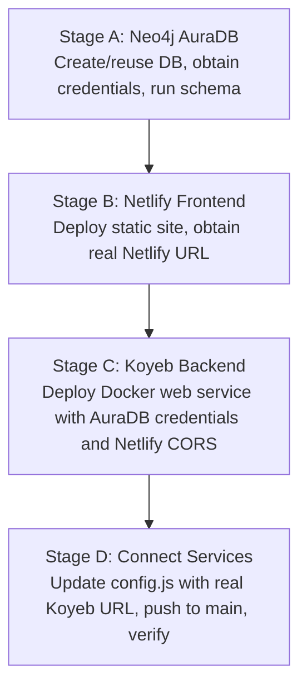

# SwiftShip DBMS-DA3 Deployment Guide: Netlify + Koyeb + Neo4j AuraDB

This guide provides end-to-end instructions for deploying the **SwiftShip Courier Management System (DBMS-DA3)** using **Netlify** (Static Frontend), **Koyeb** (Docker MicroVM Backend), and **Neo4j AuraDB** (Cloud Graph Database).

> [!NOTE]
> All deployment files and configurations are strictly confined to `DBMS-DA3/`. The existing DA2 project (Oracle database, AWS EC2 scripts, and systemd services) remains 100% intact and preserved.

---

## 1. Architecture Overview

```mermaid
flowchart LR
    Browser["Client Browser"]
    Frontend["Netlify Static Site<br/><code>DBMS-DA3/frontend</code><br/>Vanilla JS / HTML / CSS"]
    Backend["Koyeb Web Service<br/><code>DBMS-DA3/backend</code><br/>Docker (Java 21 / Spring Boot 3.3.5)"]
    AuraDB["Neo4j AuraDB (Cloud)<br/><code>neo4j+s://...databases.neo4j.io</code>"]

    Browser -->|HTTPS| Frontend
    Frontend -->|REST API with Strict CORS| Backend
    Backend -->|Bolt+TLS (neo4j+s)| AuraDB
```

- **Frontend**: Hosted on **Netlify** (Free tier, global CDN) from `DBMS-DA3/frontend/`.
- **Backend**: Hosted on **Koyeb** (Free tier MicroVM, Docker build) from `DBMS-DA3/backend/`.
- **Database**: Cloud-hosted **Neo4j AuraDB Free** instance via secure `neo4j+s://`.

---

## 2. Correct Order of Manual Cloud Deployment

Deploying in this exact order ensures you have your real Netlify URL ready before setting up Koyeb, so you can configure CORS accurately on the very first try.



---

### Stage A — Neo4j AuraDB

1. Log in to the [Neo4j Aura Console](https://console.neo4j.io/).
2. Create or reuse an instance:
   - Click **New Instance** → Choose **AuraDB Free**.
   - Name: `SwiftShip-Courier` (or any preferred name).
   - **Download and securely save the credentials text file** containing:
     - **URI**: `neo4j+s://<dbid>.databases.neo4j.io`
     - **Username**: `neo4j`
     - **Password**: `<your-auradb-password>`
3. Once the instance state shows **Running**, click **Query** (or open Neo4j Browser) and execute the schema initialization script from:
   ```cypher
   // Copy and run the entire contents of:
   // DBMS-DA3/backend/schema/neo4j_schema.cypher
   ```
   This creates all uniqueness constraints and performance indexes using safe `IF NOT EXISTS` syntax without dropping existing data.
4. Confirm the database is running and ready to accept connections.

---

### Stage B — Netlify Frontend

1. Log in to [Netlify](https://app.netlify.com/).
2. Click **Add new site** → **Import an existing project** → **GitHub**.
3. Authorize access to `NithinSarvesh/CourierManagement`.
4. Configure the build and deployment parameters:
   | Setting | Value | Explanation |
   |---|---|---|
   | **Branch to deploy** | `main` | Production branch |
   | **Base directory** | `DBMS-DA3/frontend` | Points Netlify directly to the static frontend |
   | **Build command** | *(Leave empty)* | Vanilla HTML/CSS/JS requires no build step |
   | **Publish directory** | `.` | Publishes index.html, styles.css, app.js, config.js |

5. Click **Deploy site**. Netlify will deploy immediately (under 10 seconds).
6. Note down your real public Netlify site URL from the dashboard:
   ```
   https://<your-site-name>.netlify.app
   ```
   *(You can rename the site under Site configuration → Change site name).*

> [!TIP]
> At this stage, opening your Netlify site will display a clear banner: `⚠️ Action Required: Koyeb Backend URL Not Configured`. This is expected because the backend has not yet been deployed.

---

### Stage C — Koyeb Backend

1. Sign up or log in to [Koyeb Dashboard](https://app.koyeb.com/).
2. Click **Create Service** and select **GitHub**.
3. Choose your repository: `NithinSarvesh/CourierManagement`.
4. Configure the service parameters:
   | Setting | Value | Explanation |
   |---|---|---|
   | **Branch** | `main` | Production branch |
   | **Builder** | **Dockerfile** | Uses multi-stage container build |
   | **Work directory** | `DBMS-DA3/backend` | Points directly to backend folder in monorepo |
   | **Dockerfile location** | `Dockerfile` | Relative to Work directory (`DBMS-DA3/backend/Dockerfile`) |
   | **Service Name** | `swiftship-backend` | Subdomain identifier |
   | **Instance Type** | **Free / Eco (Nano / 512 MB RAM)** | Default free microVM |

5. **Exposed Port Configuration**:
   - In the **Ports** section:
     - **Port**: `8080`
     - **Protocol**: `HTTP`
     - **Path**: `/`
   > [!NOTE]
   > Koyeb exposes port `8080` to public HTTPS traffic (`https://<service-name>-<org>.koyeb.app`) and injects `PORT=8080` into the container. Spring Boot reads `${PORT:${SERVER_PORT:8082}}` and binds automatically to `0.0.0.0:8080`. When running locally outside Docker, it retains port `8082`.

6. **Health Check Configuration**:
   - Type: `HTTP`
   - Path: `/actuator/health`
   - Port: `8080`
   - Grace period / Initial delay: `60s` (allows JVM container to initialize and verify database)
   - Interval: `30s`
   - Timeout: `5s`

7. **Environment Variables**:
   Add the following variables under **Environment variables**:
   | Variable | Value | Description |
   |---|---|---|
   | `NEO4J_URI` | `neo4j+s://<dbid>.databases.neo4j.io` | Your actual AuraDB connection URI |
   | `NEO4J_USERNAME` | `neo4j` | Database username |
   | `NEO4J_PASSWORD` | `<your-auradb-password>` | Database password |
   | `NEO4J_DATABASE` | `neo4j` | Database name |
   | `CORS_ALLOWED_ORIGINS` | `https://<your-site-name>.netlify.app` | **Your real Netlify URL from Stage B** (no trailing slash) |

8. Click **Deploy**.
9. Wait for build and deployment to complete. Check the deployment logs:
   - Look for: `Neo4j database connectivity verified successfully (ping=1).`
   - Look for: `Started CourierManagementSystemApplication in ... seconds`
   - Note down your real public Koyeb backend URL:
     ```
     https://<service-name>-<org>.koyeb.app
     ```

---

### Stage D — Connect the Services

1. Open [`DBMS-DA3/frontend/config.js`](file:///d:/projects/CourierManagement/DBMS-DA3/frontend/config.js) in your local repository.
2. Set `apiBase` to your actual Koyeb public HTTPS URL:
   ```javascript
   window.SWIFTSHIP_CONFIG = {
     apiBase: 'https://<service-name>-<org>.koyeb.app'
   };
   ```
3. Commit and push only this configuration change to `main`:
   ```bash
   git add DBMS-DA3/frontend/config.js
   git commit -m "fix(da3): point production frontend to live Koyeb backend"
   git push origin main
   ```
4. Wait for Netlify to auto-deploy the update (under 10 seconds).
5. Open your Netlify site (`https://<your-site-name>.netlify.app`).
   - The status badge in the sidebar will change from yellow to green: `● Connected`.
   - The setup banner disappears, and the live dashboard renders.

> [!TIP]
> **Instant Browser Override**: If you want to verify the connection immediately before committing `config.js`, open your Netlify site, click **Configure URL** in the banner (or the ⚙ icon in the sidebar), paste your Koyeb URL, and click OK. The page will reload and connect live using `localStorage`.

---

## 3. Instance Sizing & Memory Management

### Koyeb Free Tier Constraints (512 MB RAM / 0.1 vCPU)
Koyeb's free tier provides a microVM with 512 MB RAM. Standard Java 21 Spring Boot applications typically allocate 500 MB+ across heap, metaspace, thread stacks, and JIT buffers, which can trigger the Linux kernel out-of-memory killer (`Exit code 137` / OOMKilled).

[`DBMS-DA3/backend/Dockerfile`](file:///d:/projects/CourierManagement/DBMS-DA3/backend/Dockerfile) has been pre-configured with memory safeguards:
- **Serial GC** (`-XX:+UseSerialGC`): Uses a single thread for garbage collection, saving 40–60 MB native memory overhead compared to G1GC.
- **Max Heap 55%** (`-XX:MaxRAMPercentage=55.0`): Caps max heap at ~280 MB, reserving ~230 MB for Metaspace, threads, native Bolt driver buffers, and microVM overhead.
- **Metaspace Cap** (`-XX:MaxMetaspaceSize=128m`): Prevents unbounded class metadata growth.
- **Clean Failover** (`-XX:+ExitOnOutOfMemoryError`): Ensures the process exits cleanly for Koyeb to restart if memory peaks.
- **Fast Entropy** (`-Djava.security.egd=file:/dev/./urandom`): Accelerates container boot time on microVMs.

### Sizing Risks & Upgrades
- **Cold Starts**: If inactive, Koyeb free services may take 20–30s to respond to the first request. The initial health check grace period must be set to `60s` to prevent premature restart during boot.
- **Heavy Load**: For high concurrency or large query datasets, upgrade to a Koyeb Small instance (1 GB or 2 GB RAM).

---

## 4. End-to-End Verification Checklist

Perform these verification steps once all three cloud services are running:

1. **Verify Backend Health**:
   Open in your browser:
   `https://<your-koyeb-app>.koyeb.app/actuator/health`
   Expected response:
   ```json
   {
     "status": "UP",
     "components": {
       "diskSpace": { "status": "UP" },
       "neo4j": { "status": "UP", "details": { "edition": "aura" } },
       "ping": { "status": "UP" }
     }
   }
   ```

2. **Verify Frontend Live Connection**:
   Open your Netlify site (`https://<your-site-name>.netlify.app`).
   - Sidebar status badge shows `● Connected`.
   - Browser Console (`F12`) has **zero** CORS errors, **zero** Mixed Content warnings, and **zero** requests to `localhost`.

3. **Verify Business Operations**:
   - **Dashboard**: Overview cards (total parcels, active deliveries, revenue) and agent leaderboard render live data.
   - **Customers**: Click **+ Add customer**, fill in test details (e.g., `Test User`, `test@example.com`, `9876543210`), click Save. Confirm the record appears in the customer table. Refresh the browser to confirm persistence in AuraDB.
   - **Parcels**: Click **+ New parcel**, select sender and receiver, specify destination and weight, save. Note the generated tracking number (e.g., `TRK...`).
   - **Tracking**: Open **Tracking**, enter the tracking number, click Track. Verify the journey timeline steps render accurately.

---

## 5. Troubleshooting Guide

| Issue | Root Cause | Exact Fix |
|---|---|---|
| **Mixed Content: The page was loaded over HTTPS but requested an insecure resource** | Backend URL in `config.js` was entered with `http://` instead of `https://` | Edit `config.js` and ensure the URL begins with `https://`. Koyeb routes all incoming traffic via TLS automatically. |
| **CORS Policy: No 'Access-Control-Allow-Origin' header** | `CORS_ALLOWED_ORIGINS` in Koyeb does not match your Netlify origin | In Koyeb service settings → **Environment variables**, update `CORS_ALLOWED_ORIGINS` to `https://<your-site-name>.netlify.app` exactly (no trailing slash). Click **Save and deploy**. |
| **Backend crash with `CRITICAL: Failed to connect to Neo4j`** | Invalid Neo4j URI or password in Koyeb env vars | Verify `NEO4J_URI` uses `neo4j+s://`, not plain `bolt://`. Verify username is `neo4j` and check the password from your AuraDB credentials file. |
| **Koyeb Health check failing / deployment timeout** | JVM startup took longer than health check grace period | In Koyeb service settings → Health Checks, ensure **Grace period** is set to `60s`. |
| **Frontend displays "Setup API (Click ⚙)"** | `config.js` has empty `apiBase` and no override in `localStorage` | Click **Configure URL** in the banner or update `config.js` with your Koyeb URL and push to `main`. |

---

## 6. Project Preservation Confirmation

- **DA2 Oracle AWS Implementation**: Preserved untouched in `courier-backend/`, `courier_frontend_ui/`, `scripts/`, `systemd/`, root batch scripts, and Git history.
- **DA3 System**: Fully isolated and self-contained in `DBMS-DA3/`.
